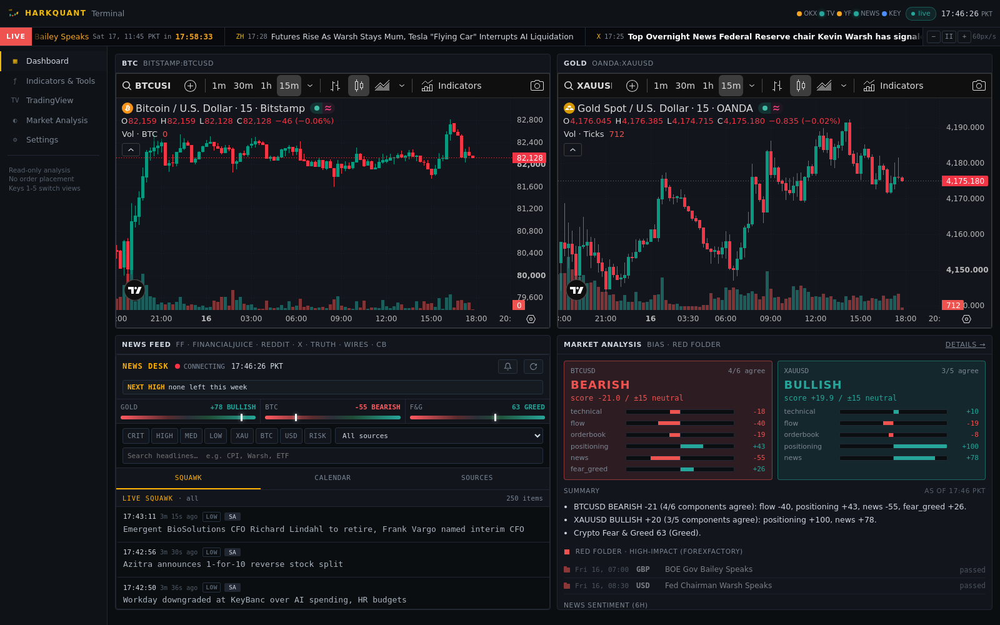
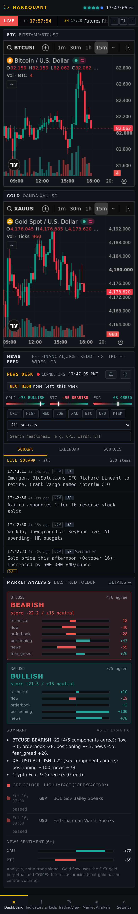
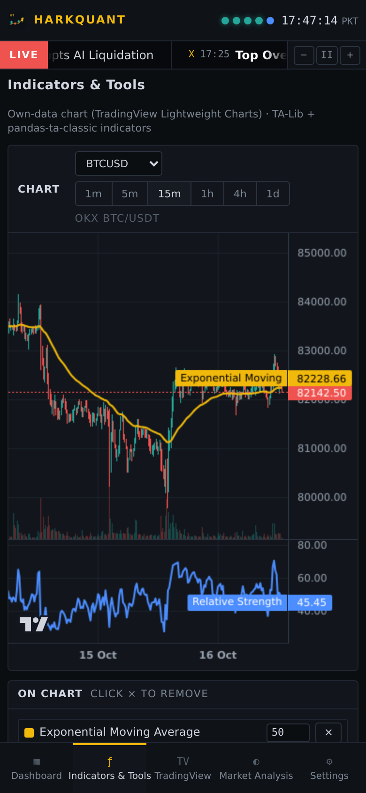
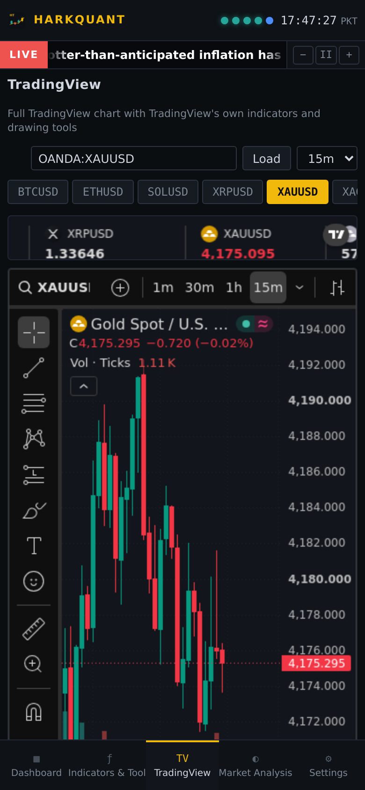
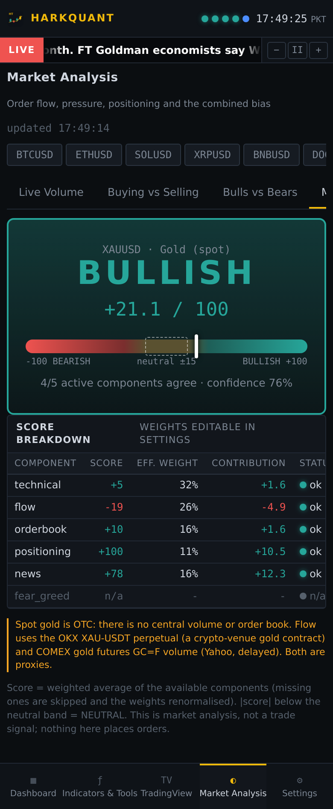
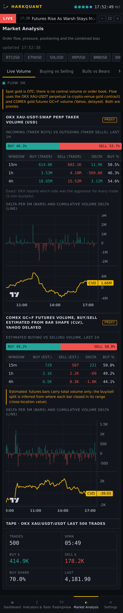
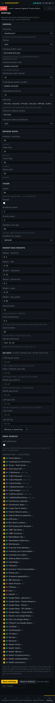

# HarkQuant Terminal

**A self-hosted, read-only market news and analysis terminal for gold, Bitcoin, crypto and major FX/CFDs.**

[](LICENSE)
[](https://www.python.org/downloads/)
[-3DDC84?logo=android&logoColor=white)](android/README.md)
[](https://github.com/cryptotechdao/harkquant-terminal/actions/workflows/ci.yml)

HarkQuant Terminal combines a 58-source news desk, an economic calendar, live order flow, technical indicators and a
transparent market-bias score in one dashboard. It ships as a Python backend (`hqterm`, FastAPI), an installable
PWA web UI and a native Android app.

It is **read-only by design**: there are no order, trade or signal-copy functions anywhere in the code, and it needs no
broker or exchange keys.



## Contents
- [Features](#features)
- [Screenshots](#screenshots)
- [Quick start](#quick-start)
- [Configuration](#configuration)
- [Architecture](#architecture)
- [Data sources and licenses](#data-sources-and-licenses)
- [Testing](#testing)
- [Roadmap](#roadmap)
- [Contributing](#contributing)
- [Disclaimer](#disclaimer)
- [License](#license)

## Features

- **Dashboard**: BTC and gold charts (TradingView embed widgets), the News Desk feed and a market-analysis summary:
  BTC and XAU bias with component bars, a plain-language summary, the **red-folder** list of ForexFactory high-impact
  events with live countdowns, and news sentiment.
- **News ticker** on every page, TV-news style: 3 current headlines and 3 upcoming high-impact events, interleaved,
  with red-folder events highlighted. Slow down, pause or speed up; the choice is saved.
- **News Desk engine**: 58 sources (squawks, central banks, statistics agencies, wires, crypto media, Reddit, X),
  de-duplication, an impact classifier (LOW to CRITICAL), per-asset direction tags, ForexFactory calendar and
  Server-Sent Events streaming. Optional LLM re-scoring of HIGH/CRITICAL headlines with any OpenAI-compatible endpoint
  (off by default).
- **Indicators & Tools**: a Lightweight Charts candle chart on the app's own data with a searchable catalog of
  **185 indicators** (TA-Lib groups plus pandas-ta-classic SuperTrend, VWAP, Ichimoku, Donchian, Keltner, HMA, VWMA,
  ZLMA, Squeeze, Choppiness, Vortex), editable parameters and candlestick-pattern markers. Tools: position-size / risk
  calculator, pivot points (classic, Fibonacci, Camarilla, Woodie), trading-sessions clock, ATR stop/target.
- **TradingView view**: the full Advanced Chart with TradingView's own indicators and drawing tools, ticker tape,
  technical-analysis gauge, mini overview and economic calendar.
- **Market Analysis** for 20 markets:
  - *Live Volume*: taker buy vs taker sell volume, delta per 5 min, CVD and the last-500-trades tape.
  - *Buying vs Selling*: order-book imbalance in ±0.1/0.25/0.5/1% bands, depth chart, aggressor delta.
  - *Bulls vs Bears*: TradingView ratings per timeframe, long/short account ratio, funding, open interest,
    news sentiment and Fear & Greed.
  - *Market Bias*: one clear BULLISH / BEARISH / NEUTRAL reading with the full score breakdown (score, weight,
    effective weight, contribution, status, proxy flags) and event-risk damping.
- **Settings**: timezone (default Asia/Karachi), theme, chart symbols, watchlist, refresh rates, ticker content,
  bias weights, neutral band, event damping, per-source news toggles with live status dots, and API keys.
- **Native Android app** (Kotlin + Jetpack Compose, Material 3): 5 screens, 20 themes, custom Canvas charts with
  pinch-zoom and crosshair, SSE live data with polling fallback, encrypted token storage.
  See [`android/README.md`](android/README.md).

### Honesty rules built in
- **No mock or demo data** in the default path. If a source fails, its status dot turns red and its panel says so.
  The rest of the page keeps working, and a last good value is served (flagged *stale*) for a while.
- Wherever a number stands in for something that does not exist centrally, it is tagged **PROXY** and explained.
  Spot gold and spot FX have no central volume or order book.
- The bias is analysis, not a signal. Missing components are skipped, never invented.

## Screenshots

| Dashboard | Indicators & Tools | TradingView |
|---|---|---|
|  |  |  |

| Market Bias | Live Volume | Settings |
|---|---|---|
|  |  |  |

Desktop and phone screenshots of every view are in [`docs/screens/`](docs/screens); Android screenshots (all 20
themes) are in [`android/screenshots/`](android/screenshots).

## Quick start

Requirements: **Python 3.11+** and Git. TA-Lib ships prebuilt wheels on PyPI since 0.6, so no C build is needed on
common platforms.

### Windows
1. Install Python 3.11+ (tick *Add python.exe to PATH*) and Git for Windows.
2. Clone the repository:
   ```bat
   git clone https://github.com/cryptotechdao/harkquant-terminal.git
   ```
3. Double-click **`Install-HarkQuant-Terminal.bat`**. It creates `.venv`, installs `requirements.txt`, puts a
   **HarkQuant Terminal** shortcut on the desktop and probes the live sources once.
4. Double-click **HarkQuant Terminal** (or `Start-HarkQuant-Terminal.bat`). It starts
   `python -m hqterm serve --port 8702`, waits for `/health` and opens `http://127.0.0.1:8702/` as an Edge app
   window. In Edge: **… > Apps > Install this site as an app**.
5. Update later with **`Update-HarkQuant-Terminal.bat`** (`git pull` + `pip install`). Your `state\` folder is never
   touched.

**Phone on the same Wi-Fi:** run `Start-HarkQuant-Terminal.bat lan`, then open `http://<PC-IP>:8702/` on the phone
and use *Add to Home Screen*. LAN mode binds `0.0.0.0` and requires the token in `state\hqt_token.txt` for any
settings or key change (reads stay open).

### Linux / macOS
```bash
git clone https://github.com/cryptotechdao/harkquant-terminal.git
cd harkquant-terminal
python3 -m venv .venv
.venv/bin/pip install -r requirements.txt
./start.sh                      # or: .venv/bin/python -m hqterm serve --port 8702
```
Open <http://127.0.0.1:8702/>. `python -m hqterm check` probes every live source once and prints a status table.

### Android
The app is a client for a HarkQuant Terminal server you run yourself.
1. Run the backend (above) somewhere your phone can reach: the same Wi-Fi (`http://192.168.x.x:8702`) or your own
   HTTPS host.
2. Build and install the app from [`android/`](android) (JDK 17 + Android SDK):
   ```bash
   cd android
   ./gradlew :app:testDebugUnitTest :app:assembleDebug
   adb install app/build/outputs/apk/debug/app-debug.apk
   ```
3. Open **Settings > Server**, enter your server URL and tap **Test**.

Release signing and screenshot tooling are described in [`android/README.md`](android/README.md).

## Configuration

| What | Where |
|---|---|
| Server URL (Android) | Set by the user in **Settings > Server**. The build default is the placeholder `https://your-server.example.com`; there is no hosted server. |
| Host / port | `HQT_HOST` (default `127.0.0.1`), `HQT_PORT` (default `8702`), or `--host` / `--port` |
| State folder | `HQT_STATE` (default `state/`, git-ignored): `settings.json`, `secrets.json`, `news.db` |
| Write protection | `HQT_TOKEN`: when set, `POST /api/settings*`, `/api/secrets` and `/api/news/refresh` need `Authorization: Bearer <token>` |
| News pollers | `HQT_NO_NEWS=1` disables them; `HQ_NEWS_DISABLE=id,id` switches off single sources |
| Contact for official feeds | `HQT_CONTACT`: your email or URL, sent in the User-Agent to sources that ask for one (e.g. BLS) |
| Optional API keys | `HQT_X_BEARER`, `HQT_NITTER_BASE`, `HQT_REDDIT_CLIENT_ID`, `HQT_REDDIT_CLIENT_SECRET`, `HQT_LLM_URL`, `HQT_LLM_MODEL`, `HQT_LLM_KEY` (or enter them in **Settings > API keys**) |

Keys entered in the UI are stored in `state/secrets.json` on the machine running the server. They are write-only from
the browser (`GET` returns only whether each key is set) and are never committed. Port 8702 was chosen so the terminal
can run next to the Hark Titans dashboard (8701).

## Architecture

```
            ┌───────────────────────── hqterm (FastAPI, Python 3.11+) ─────────────────────────┐
 OKX (ccxt) ─┤ market.py    bars, trades, order book, taker volume, funding, L/S, OI          │
 Yahoo ──────┤ market.py    futures volume (proxy), FX/index bars                             │
 TradingView ┤ market.py    technical ratings (tradingview-ta)                                │──► REST /api/*
 58 feeds ───┤ newsdesk.py  pollers, dedupe, impact classifier, FF calendar, SQLite           │──► SSE  /api/stream, /api/news/stream
             │ indicators.py TA-Lib + pandas-ta-classic   tools.py  sizing, pivots, ATR       │──► PWA  / (static/)
             │ bias.py / analysis.py  weighted bias, summary, ticker, red folder             │
             │ config.py    settings + write-only secrets, token guard                        │
            └──────────────────────────────────────────────────────────────────────────────────┘
                     ▲                                   ▲
           PWA web UI (static/, no build step)   Android app (android/, Kotlin + Compose)
```

| Path | Contents |
|---|---|
| `hqterm/` | FastAPI app (`app.py`), market data (`market.py`), bias (`bias.py`), analysis/ticker (`analysis.py`), indicators (`indicators.py`), tools (`tools.py`), settings/secrets (`config.py`), symbols (`symbols.py`), News Desk engine + router (`newsdesk.py`, `news_api.py`) |
| `static/` | PWA shell: `index.html`, `assets/` (core, tv, ticker, views, app, css), `news/` (News Desk UI), `vendor/` (Lightweight Charts), icons, service worker |
| `android/` | Native Android client (MVVM: `data/` → `ui/ViewModels.kt` → stateless composables) |
| `tests/` | pytest suite |
| `scripts/shoot.py` | Screenshots of every view (Playwright) |
| `docs/` | [`DASHBOARD.md`](docs/DASHBOARD.md) (views, endpoints, security), [`SOURCES.md`](docs/SOURCES.md) (every source: live, needs a key, or proxy), `screens/` |
| `state/` | Runtime only, git-ignored |

The dashboard shell, look and feel, PWA setup and Windows launchers are adapted from the Hark Titans dashboard shell;
the news engine and its UI come from the HarkQuant News Desk module.

## Data sources and licenses

HarkQuant Terminal only reads public data. Each provider's own terms of use apply to the data you fetch with it.
Full per-source status (live / needs a key / proxy) is in [`docs/SOURCES.md`](docs/SOURCES.md).

| Data | Source | Library / license |
|---|---|---|
| Embedded charts, TA gauge, ticker tape, economic calendar widget | TradingView official embed widgets | TradingView widget terms |
| Own-data candle chart | TradingView Lightweight Charts v5.2.1 (vendored) | Apache-2.0 ([`static/vendor/LICENSE-lightweight-charts.txt`](static/vendor/LICENSE-lightweight-charts.txt)) |
| Technical ratings | TradingView scanner via `tradingview-ta` | MIT |
| Crypto and gold-perpetual bars, trades, order book, funding, long/short, OI | OKX public API via `ccxt` (no keys) | MIT (ccxt); OKX API terms |
| Futures volume (proxy) and FX/index bars | Yahoo Finance via `yfinance` | Apache-2.0 (yfinance); Yahoo terms, personal use |
| Indicators | TA-Lib (Python wrapper) and pandas-ta-classic | BSD-2-Clause; MIT |
| Economic calendar | ForexFactory weekly calendar feed (faireconomy.media) | ForexFactory terms |
| Headlines | Public RSS/Atom feeds of central banks, statistics agencies, news wires and crypto media; Reddit; X (with your own key) | Headlines and links only; content belongs to each publisher |
| Crypto Fear & Greed | alternative.me API | free API, attribution |
| Backend | FastAPI, Uvicorn, HTTPX, feedparser, pandas, NumPy | MIT; BSD-3-Clause; BSD-3-Clause; BSD-2-Clause; BSD-3-Clause; BSD-3-Clause |

## Testing

```bash
python -m pytest -q
```
runs the offline suite (34 tests: bias maths, tools, flow maths, indicators, settings/secrets API, the token guard,
the absence of any trading endpoint, and ticker/red-folder logic on a seeded database). The 3 live-source tests are
skipped by default; run them with:
```bash
HQT_LIVE_TESTS=1 python -m pytest -q tests/test_live_sources.py   # hits OKX and Yahoo for real
```
Android unit tests: `cd android && ./gradlew :app:testDebugUnitTest`. CI runs the Python suite on every push and
pull request.

## Roadmap

- [ ] Android: user-selectable display time zone (times are currently always shown in Asia/Karachi)
- [ ] `pyproject.toml` packaging with an `hqterm` console command
- [ ] Docker image / `docker compose` file for self-hosting
- [ ] Android unit tests in CI
- [ ] API reference for the REST and SSE endpoints
- [ ] Replace the failing direct feeds (Yahoo Finance, Kitco, FXStreet, DailyFX, ForexFactory news RSS) with working alternatives
- [ ] Remove pandas / pandas-ta-classic deprecation warnings (VWAP period conversion, Ichimoku tuple return)

See the [open issues](https://github.com/cryptotechdao/harkquant-terminal/issues) for details and good first issues.

## Contributing

Contributions are welcome. Please read [CONTRIBUTING.md](CONTRIBUTING.md) and our
[Code of Conduct](CODE_OF_CONDUCT.md). Security issues: see [SECURITY.md](SECURITY.md). Release history is in
[CHANGELOG.md](CHANGELOG.md).

## Disclaimer

HarkQuant Terminal is an information and analysis tool. **It is not financial advice**, and nothing it shows (bias
readings, ratings, sentiment, summaries) is a recommendation or a trade signal. It is **read-only**: it cannot place,
modify or cancel orders and has **no trading functionality**. Market data can be delayed, incomplete or wrong, and
values tagged PROXY are approximations. Trading carries a high risk of loss; do your own research.

## License

[MIT](LICENSE) © 2026 Sami Ullah
